# 合成参考证据审阅册

日期：2026-11-03。12情景、72消息、12图、48题；dev=16，heldout=32。

全部为助手编制的合成资料与标签草稿；人工复核0题。保留集不是秘密盲测，本阶段没有模型实验或质量分数。

每题需核对题意、参考事实、证据充分性、替代证据、不可回答依据及范围。最小集合内部为AND，集合之间为OR。

事实正确性、引用支持性和图像实际核查分别检查。未标正的其他资料为未穷尽判断，不直接认定为负例。

人工复核状态均待完成；请记录复核者、日期与修改理由，正式实验前另行冻结修订版本。

## d-cache / dev / cache-expiry

**d-cache-m0**（回复：无）

合成事件 CACHE_TTL_17：atlas-staging-r3 的配置缓存仍返回旧条目，本地记录显示 TTL 为30秒。

**d-cache-m1**（回复：d-cache-m0）

建议把 TTL 改为90秒来减少刷新；这是尚未执行、尚未验证的建议。

**d-cache-m2**（回复：d-cache-m1）

核查发现旧条目源于缓存代次键未同步。修订方案是切换 generation_key=g17，再把 TTL 设为73秒，不能仅延长 TTL。

**d-cache-m3**（回复：d-cache-m2）

合成验证单 DV-C01：atlas-staging-r3 已使用 generation_key=g17、TTL=73秒，指定旧条目用例不再复现；本结论仅覆盖该测试环境。

**d-cache-m4**（回复：d-cache-m3）

Atlas cache board 是本事件的合成观察面板。请核查图中 Canary 卡片圆点；文字消息不描述其颜色或位置。

**d-cache-m5**（回复：无）

旧环境 atlas-staging-r2 的历史配置为 TTL=48秒、generation_key=g12，不能作为 r3 的验证结论。

### q-dev-001

CACHE_TTL_17 在 atlas-staging-r3 最后验证的 TTL 和代次键分别是什么？

类别：fact；核图要求：False；预期状态：completed。
允许范围：d-cache, d-upload, d-backoff, d-config。

- 参考事实：已验证 TTL=73秒且 generation_key=g17；限 atlas-staging-r3。 支持：d-cache-m3

拟定最小证据集合：[["d-cache-m3"]]

- [ ] 题意、等价答案与必要限定已复核
- [ ] 证据充分性、替代证据或不可回答原因已复核
- [ ] 若涉及图片，已对照原图检查颜色、位置与区域

复核者 / 日期 / 修改理由：待填写。

### q-dev-002

梳理 CACHE_TTL_17 的起始现象、最初建议、修订依据及已验证结果，说明结论适用于哪里。

类别：context；核图要求：False；预期状态：completed。
允许范围：d-cache, d-upload, d-backoff, d-config。

- 参考事实：合成事件 CACHE_TTL_17：atlas-staging-r3 的配置缓存仍返回旧条目，本地记录显示 TTL 为30秒。 支持：d-cache-m0
- 参考事实：建议把 TTL 改为90秒来减少刷新；这是尚未执行、尚未验证的建议。 支持：d-cache-m1
- 参考事实：核查发现旧条目源于缓存代次键未同步。修订方案是切换 generation_key=g17，再把 TTL 设为73秒，不能仅延长 TTL。 支持：d-cache-m2
- 参考事实：合成验证单 DV-C01：atlas-staging-r3 已使用 generation_key=g17、TTL=73秒，指定旧条目用例不再复现；本结论仅覆盖该测试环境。 支持：d-cache-m3

拟定最小证据集合：[["d-cache-m0", "d-cache-m1", "d-cache-m2", "d-cache-m3"]]

- [ ] 题意、等价答案与必要限定已复核
- [ ] 证据充分性、替代证据或不可回答原因已复核
- [ ] 若涉及图片，已对照原图检查颜色、位置与区域

复核者 / 日期 / 修改理由：待填写。

### q-dev-003

在 Atlas cache board 原图中，Canary 卡片的圆点是什么颜色，位于卡片左端还是右端？

类别：visual；核图要求：True；预期状态：completed。
允许范围：d-cache, d-upload, d-backoff, d-config。

- 参考事实：Canary卡片圆点为蓝色。 支持：d-cache-panel
- 参考事实：圆点位于卡片左端。 支持：d-cache-panel

拟定最小证据集合：[["d-cache-panel"]]

图片真值（作者参数，待视觉复核）：{"evidence_id": "d-cache-panel", "label": "Canary", "card_bbox_xyxy": [60, 185, 440, 410], "marker_bbox_xyxy": [80, 290, 131, 341], "marker_center_xy": [105, 315], "color": "blue", "rgb_hex": "#2563eb", "side": "left"}

- [ ] 题意、等价答案与必要限定已复核
- [ ] 证据充分性、替代证据或不可回答原因已复核
- [ ] 若涉及图片，已对照原图检查颜色、位置与区域

复核者 / 日期 / 修改理由：待填写。

### q-dev-004

atlas-staging-r3 单实例支持的最大并发请求数是多少？

类别：unanswerable；核图要求：False；预期状态：insufficient。
允许范围：d-cache, d-upload, d-backoff, d-config。

不可回答依据：资料只记录缓存修订和指定用例，没有并发容量记录。

- [ ] 题意、等价答案与必要限定已复核
- [ ] 证据充分性、替代证据或不可回答原因已复核
- [ ] 若涉及图片，已对照原图检查颜色、位置与区域

复核者 / 日期 / 修改理由：待填写。

## d-upload / dev / multipart-upload

**d-upload-m0**（回复：无）

合成事件 UPLOAD_PART_06：harbor-integration-r4 的分片合并校验失败，故障样例使用4 MiB分片。

**d-upload-m1**（回复：d-upload-m0）

有人建议统一改成8 MiB分片；该建议尚未通过网关边界用例。

**d-upload-m2**（回复：d-upload-m1）

边界用例要求当前链路采用6 MiB分片，并携带 part_digest。问题修订为同时调整分片尺寸和校验字段，不是只扩大分片。

**d-upload-m3**（回复：d-upload-m2）

合成验证单 DV-U02：harbor-integration-r4 使用 part_size=6 MiB、part_digest=required，合并后摘要与源文件相同；未测试生产环境。

**d-upload-m4**（回复：d-upload-m3）

Harbor upload board 是本事件的人工合成面板，附有 Upload 卡片；卡片圆点信息只在原图中给出。

**d-upload-m5**（回复：无）

旧环境 harbor-integration-r2 曾使用12 MiB分片和可选摘要；旧配置不适用于 r4 的边界用例。

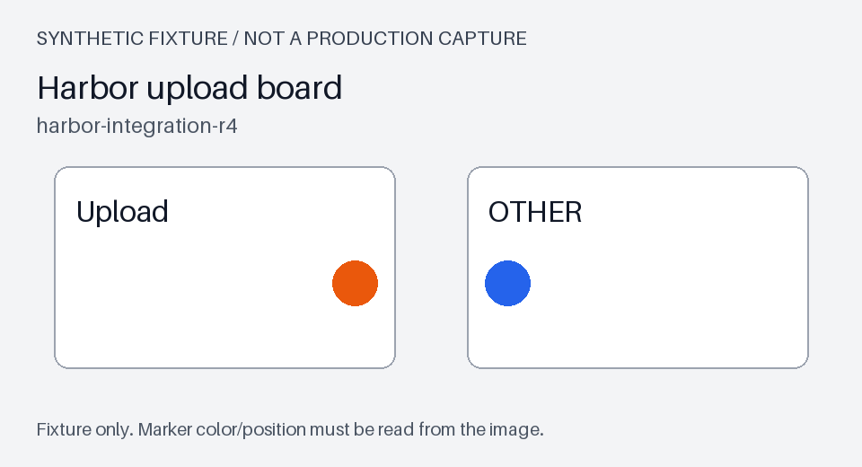

### q-dev-005

在 harbor-integration-r4，UPLOAD_PART_06 最终验证了多大分片，摘要字段有什么要求？

类别：fact；核图要求：False；预期状态：completed。
允许范围：d-cache, d-upload, d-backoff, d-config。

- 参考事实：part_size=6 MiB，part_digest=required；仅完成 harbor-integration-r4 的合成验证。 支持：d-upload-m3

拟定最小证据集合：[["d-upload-m3"]]

- [ ] 题意、等价答案与必要限定已复核
- [ ] 证据充分性、替代证据或不可回答原因已复核
- [ ] 若涉及图片，已对照原图检查颜色、位置与区域

复核者 / 日期 / 修改理由：待填写。

### q-dev-006

UPLOAD_PART_06 为什么不能只沿用最初的扩大片建议？请串起故障、建议、边界修订及验证范围。

类别：context；核图要求：False；预期状态：completed。
允许范围：d-cache, d-upload, d-backoff, d-config。

- 参考事实：合成事件 UPLOAD_PART_06：harbor-integration-r4 的分片合并校验失败，故障样例使用4 MiB分片。 支持：d-upload-m0
- 参考事实：有人建议统一改成8 MiB分片；该建议尚未通过网关边界用例。 支持：d-upload-m1
- 参考事实：边界用例要求当前链路采用6 MiB分片，并携带 part_digest。问题修订为同时调整分片尺寸和校验字段，不是只扩大分片。 支持：d-upload-m2
- 参考事实：合成验证单 DV-U02：harbor-integration-r4 使用 part_size=6 MiB、part_digest=required，合并后摘要与源文件相同；未测试生产环境。 支持：d-upload-m3

拟定最小证据集合：[["d-upload-m0", "d-upload-m1", "d-upload-m2", "d-upload-m3"]]

- [ ] 题意、等价答案与必要限定已复核
- [ ] 证据充分性、替代证据或不可回答原因已复核
- [ ] 若涉及图片，已对照原图检查颜色、位置与区域

复核者 / 日期 / 修改理由：待填写。

### q-dev-007

请看 Harbor upload board 的 Upload 卡片：圆点为哪种颜色，在卡片内靠左还是靠右？

类别：visual；核图要求：True；预期状态：completed。
允许范围：d-cache, d-upload, d-backoff, d-config。

- 参考事实：Upload卡片圆点为橙色。 支持：d-upload-panel
- 参考事实：圆点位于卡片右端。 支持：d-upload-panel

拟定最小证据集合：[["d-upload-panel"]]

图片真值（作者参数，待视觉复核）：{"evidence_id": "d-upload-panel", "label": "Upload", "card_bbox_xyxy": [60, 185, 440, 410], "marker_bbox_xyxy": [370, 290, 421, 341], "marker_center_xy": [395, 315], "color": "orange", "rgb_hex": "#ea580c", "side": "right"}

- [ ] 题意、等价答案与必要限定已复核
- [ ] 证据充分性、替代证据或不可回答原因已复核
- [ ] 若涉及图片，已对照原图检查颜色、位置与区域

复核者 / 日期 / 修改理由：待填写。

### q-dev-008

生产上传网关允许的单文件最大容量是多少 GiB？

类别：unanswerable；核图要求：False；预期状态：insufficient。
允许范围：d-cache, d-upload, d-backoff, d-config。

不可回答依据：只有集成环境分片记录，没有生产网关单文件容量配置。

- [ ] 题意、等价答案与必要限定已复核
- [ ] 证据充分性、替代证据或不可回答原因已复核
- [ ] 若涉及图片，已对照原图检查颜色、位置与区域

复核者 / 日期 / 修改理由：待填写。

## d-backoff / dev / queue-backoff

**d-backoff-m0**（回复：无）

合成事件 QUEUE_RETRY_23：cedar-qa-r6 的任务在重试时被重复消费；记录中缺少幂等键。

**d-backoff-m1**（回复：d-backoff-m0）

最初建议固定等待2秒后无限重试。该建议未执行，不是已通过方案。

**d-backoff-m2**（回复：d-backoff-m1）

修订采用指数退避，base_delay=3秒、max_attempts=4，并要求 idempotency_key；缺少幂等键时不能套用该结论。

**d-backoff-m3**（回复：d-backoff-m2）

合成验证单 DV-Q03：cedar-qa-r6 在 idempotency_key 开启条件下，base_delay=3秒、max_attempts=4，重复投递样例只执行一次业务动作。

**d-backoff-m4**（回复：d-backoff-m3）

Cedar retry board 是合成面板，Worker 卡片的圆点需从附件原图核查，正文没有颜色说明。

**d-backoff-m5**（回复：无）

旧环境 cedar-qa-r4 的 base_delay=5秒、max_attempts=2，未覆盖 r6 的幂等样例。

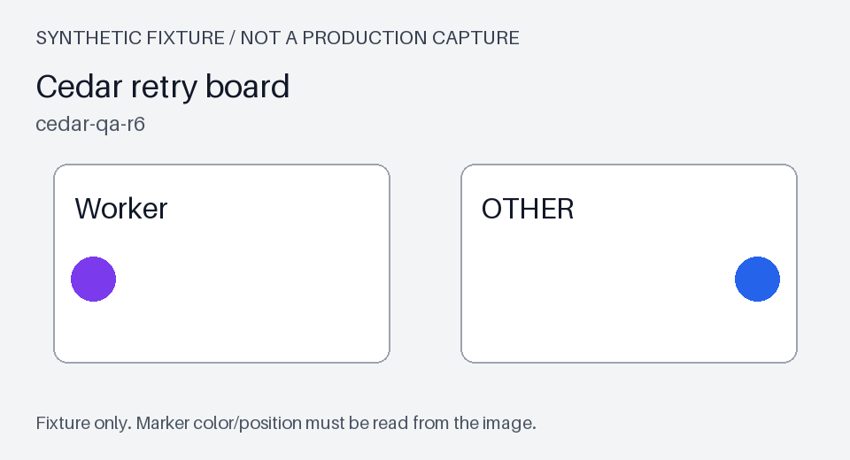

### q-dev-009

QUEUE_RETRY_23 在 cedar-qa-r6 通过验证的初始退避时间和最大尝试次数是多少？前提是什么？

类别：fact；核图要求：False；预期状态：completed。
允许范围：d-cache, d-upload, d-backoff, d-config。

- 参考事实：base_delay=3秒、max_attempts=4，前提为 idempotency_key 开启；范围 cedar-qa-r6。 支持：d-backoff-m3

拟定最小证据集合：[["d-backoff-m3"]]

- [ ] 题意、等价答案与必要限定已复核
- [ ] 证据充分性、替代证据或不可回答原因已复核
- [ ] 若涉及图片，已对照原图检查颜色、位置与区域

复核者 / 日期 / 修改理由：待填写。

### q-dev-010

请说明 QUEUE_RETRY_23 从重复消费到修订验证的过程，区分未执行建议与需要满足的前提。

类别：context；核图要求：False；预期状态：completed。
允许范围：d-cache, d-upload, d-backoff, d-config。

- 参考事实：合成事件 QUEUE_RETRY_23：cedar-qa-r6 的任务在重试时被重复消费；记录中缺少幂等键。 支持：d-backoff-m0
- 参考事实：最初建议固定等待2秒后无限重试。该建议未执行，不是已通过方案。 支持：d-backoff-m1
- 参考事实：修订采用指数退避，base_delay=3秒、max_attempts=4，并要求 idempotency_key；缺少幂等键时不能套用该结论。 支持：d-backoff-m2
- 参考事实：合成验证单 DV-Q03：cedar-qa-r6 在 idempotency_key 开启条件下，base_delay=3秒、max_attempts=4，重复投递样例只执行一次业务动作。 支持：d-backoff-m3

拟定最小证据集合：[["d-backoff-m0", "d-backoff-m1", "d-backoff-m2", "d-backoff-m3"]]

- [ ] 题意、等价答案与必要限定已复核
- [ ] 证据充分性、替代证据或不可回答原因已复核
- [ ] 若涉及图片，已对照原图检查颜色、位置与区域

复核者 / 日期 / 修改理由：待填写。

### q-dev-011

Cedar retry board 里 Worker 卡片的圆点是什么颜色，位于卡片的哪一端？

类别：visual；核图要求：True；预期状态：completed。
允许范围：d-cache, d-upload, d-backoff, d-config。

- 参考事实：Worker卡片圆点为紫色。 支持：d-backoff-panel
- 参考事实：圆点位于卡片左端。 支持：d-backoff-panel

拟定最小证据集合：[["d-backoff-panel"]]

图片真值（作者参数，待视觉复核）：{"evidence_id": "d-backoff-panel", "label": "Worker", "card_bbox_xyxy": [60, 185, 440, 410], "marker_bbox_xyxy": [80, 290, 131, 341], "marker_center_xy": [105, 315], "color": "purple", "rgb_hex": "#7c3aed", "side": "left"}

- [ ] 题意、等价答案与必要限定已复核
- [ ] 证据充分性、替代证据或不可回答原因已复核
- [ ] 若涉及图片，已对照原图检查颜色、位置与区域

复核者 / 日期 / 修改理由：待填写。

### q-dev-012

cedar-prod 的重试初始等待时间已经配置成多少秒？

类别：unanswerable；核图要求：False；预期状态：insufficient。
允许范围：d-cache, d-upload, d-backoff, d-config。

不可回答依据：当前资料仅有两个 QA 版本，不能推断 cedar-prod 的配置。

- [ ] 题意、等价答案与必要限定已复核
- [ ] 证据充分性、替代证据或不可回答原因已复核
- [ ] 若涉及图片，已对照原图检查颜色、位置与区域

复核者 / 日期 / 修改理由：待填写。

## d-config / dev / configuration-rollout

**d-config-m0**（回复：无）

合成事件 CFG_ROLLOUT_31：maple-sandbox-r2 的配置版本混用，部分样例仍读取旧发布快照。

**d-config-m1**（回复：d-config-m0）

最初建议直接切换50%的样例租户；这项建议还没有执行记录。

**d-config-m2**（回复：d-config-m1）

核查后改为 rollout_ratio=15%，并同时开启 cfg_gate；旧快照必须先隔离，不能把扩大比例当作修复。

**d-config-m3**（回复：d-config-m2）

合成验证单 DV-F04：maple-sandbox-r2 使用 cfg_rev=27、rollout_ratio=15%、cfg_gate=true，指定样例均读取修订快照；只涉及合成租户。

**d-config-m4**（回复：d-config-m3）

Maple rollout board 为合成发布面板，Beta 卡片的圆点由原图表达，不在文字中标注。

**d-config-m5**（回复：无）

旧环境 maple-sandbox-r1 的 rollout_ratio=35%、cfg_rev=19，不是 r2 的发布依据。

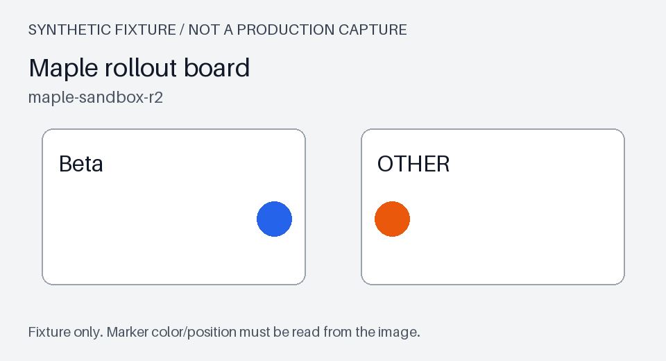

### q-dev-013

CFG_ROLLOUT_31 在 maple-sandbox-r2 最后确认的发布比例、配置版本和开关是什么？

类别：fact；核图要求：False；预期状态：completed。
允许范围：d-cache, d-upload, d-backoff, d-config。

- 参考事实：cfg_rev=27、rollout_ratio=15%、cfg_gate=true，限 maple-sandbox-r2 的合成租户。 支持：d-config-m3

拟定最小证据集合：[["d-config-m3"]]

- [ ] 题意、等价答案与必要限定已复核
- [ ] 证据充分性、替代证据或不可回答原因已复核
- [ ] 若涉及图片，已对照原图检查颜色、位置与区域

复核者 / 日期 / 修改理由：待填写。

### q-dev-014

CFG_ROLLOUT_31 最初为什么要排查快照？请连同早期建议、最终修订及验证范围一起回答。

类别：context；核图要求：False；预期状态：completed。
允许范围：d-cache, d-upload, d-backoff, d-config。

- 参考事实：合成事件 CFG_ROLLOUT_31：maple-sandbox-r2 的配置版本混用，部分样例仍读取旧发布快照。 支持：d-config-m0
- 参考事实：最初建议直接切换50%的样例租户；这项建议还没有执行记录。 支持：d-config-m1
- 参考事实：核查后改为 rollout_ratio=15%，并同时开启 cfg_gate；旧快照必须先隔离，不能把扩大比例当作修复。 支持：d-config-m2
- 参考事实：合成验证单 DV-F04：maple-sandbox-r2 使用 cfg_rev=27、rollout_ratio=15%、cfg_gate=true，指定样例均读取修订快照；只涉及合成租户。 支持：d-config-m3

拟定最小证据集合：[["d-config-m0", "d-config-m1", "d-config-m2", "d-config-m3"]]

- [ ] 题意、等价答案与必要限定已复核
- [ ] 证据充分性、替代证据或不可回答原因已复核
- [ ] 若涉及图片，已对照原图检查颜色、位置与区域

复核者 / 日期 / 修改理由：待填写。

### q-dev-015

Maple rollout board 的 Beta 卡片圆点是什么颜色，位于左端还是右端？

类别：visual；核图要求：True；预期状态：completed。
允许范围：d-cache, d-upload, d-backoff, d-config。

- 参考事实：Beta卡片圆点为蓝色。 支持：d-config-panel
- 参考事实：圆点位于卡片右端。 支持：d-config-panel

拟定最小证据集合：[["d-config-panel"]]

图片真值（作者参数，待视觉复核）：{"evidence_id": "d-config-panel", "label": "Beta", "card_bbox_xyxy": [60, 185, 440, 410], "marker_bbox_xyxy": [370, 290, 421, 341], "marker_center_xy": [395, 315], "color": "blue", "rgb_hex": "#2563eb", "side": "right"}

- [ ] 题意、等价答案与必要限定已复核
- [ ] 证据充分性、替代证据或不可回答原因已复核
- [ ] 若涉及图片，已对照原图检查颜色、位置与区域

复核者 / 日期 / 修改理由：待填写。

### q-dev-016

在本次允许读取的范围中，maple-sandbox-r2 已验证的 cfg_rev 是多少？

类别：unanswerable；核图要求：False；预期状态：insufficient。
允许范围：d-cache, d-upload, d-backoff。

不可回答依据：本题请求范围排除了 Maple 情景；即使离线参考包中存在该记录，也不能作为本次回答依据。

- [ ] 题意、等价答案与必要限定已复核
- [ ] 证据充分性、替代证据或不可回答原因已复核
- [ ] 若涉及图片，已对照原图检查颜色、位置与区域

复核者 / 日期 / 修改理由：待填写。

## h-timezone / heldout / daily-aggregation

**h-timezone-m0**（回复：无）

合成事件 ANALYTICS_DAY_41：nova-qa-r5 的日报把边界事件归入前一天，聚合表达式仍按 UTC 截日。

**h-timezone-m1**（回复：h-timezone-m0）

最初建议只修改应用服务器的 TZ 环境变量；该建议没有数据库聚合验证记录。

**h-timezone-m2**（回复：h-timezone-m1）

修订是在聚合表达式中显式使用 Asia/Shanghai，再截取业务日期，不能依赖服务器本地时区。

**h-timezone-m3**（回复：h-timezone-m2）

合成验证单 HV-T01：nova-qa-r5 按 Asia/Shanghai 聚合，样例 2026-10-05T16:30:00Z 被归入2026-10-06；未证明其他业务时区都适用。

**h-timezone-m4**（回复：h-timezone-m3）

Nova day board 是此边界样例的合成面板，Timezone 卡片圆点的位置和颜色仅见附件原图。

**h-timezone-m5**（回复：无）

旧环境 nova-qa-r3 仍按 UTC 归档，该样例日期为2026-10-05，不能替代 r5 业务时区验证。

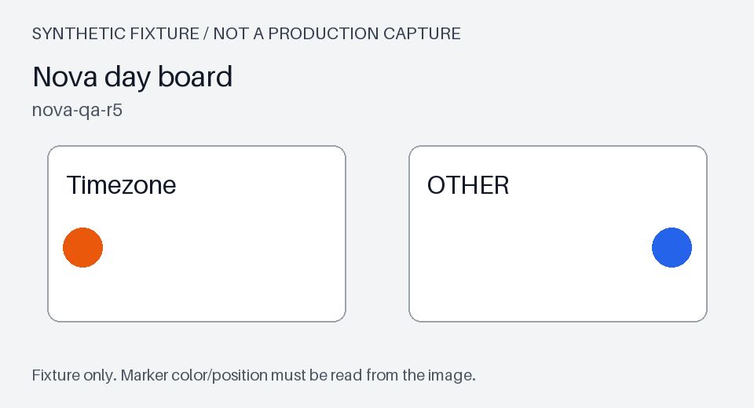

### q-heldout-001

ANALYTICS_DAY_41 在 nova-qa-r5 使用什么聚合时区，边界样例被归到哪一天？

类别：fact；核图要求：False；预期状态：completed。
允许范围：h-timezone, h-auth, h-index, h-table, h-route, h-reconcile, h-audit, h-heartbeat。

- 参考事实：使用 Asia/Shanghai，样例归入2026-10-06；只验证 nova-qa-r5。 支持：h-timezone-m3

拟定最小证据集合：[["h-timezone-m3"]]

- [ ] 题意、等价答案与必要限定已复核
- [ ] 证据充分性、替代证据或不可回答原因已复核
- [ ] 若涉及图片，已对照原图检查颜色、位置与区域

复核者 / 日期 / 修改理由：待填写。

### q-heldout-002

请按证据说明 ANALYTICS_DAY_41 的错日现象、最初建议为何不足、修订方法和测试结论的适用边界。

类别：context；核图要求：False；预期状态：completed。
允许范围：h-timezone, h-auth, h-index, h-table, h-route, h-reconcile, h-audit, h-heartbeat。

- 参考事实：合成事件 ANALYTICS_DAY_41：nova-qa-r5 的日报把边界事件归入前一天，聚合表达式仍按 UTC 截日。 支持：h-timezone-m0
- 参考事实：最初建议只修改应用服务器的 TZ 环境变量；该建议没有数据库聚合验证记录。 支持：h-timezone-m1
- 参考事实：修订是在聚合表达式中显式使用 Asia/Shanghai，再截取业务日期，不能依赖服务器本地时区。 支持：h-timezone-m2
- 参考事实：合成验证单 HV-T01：nova-qa-r5 按 Asia/Shanghai 聚合，样例 2026-10-05T16:30:00Z 被归入2026-10-06；未证明其他业务时区都适用。 支持：h-timezone-m3

拟定最小证据集合：[["h-timezone-m0", "h-timezone-m1", "h-timezone-m2", "h-timezone-m3"]]

- [ ] 题意、等价答案与必要限定已复核
- [ ] 证据充分性、替代证据或不可回答原因已复核
- [ ] 若涉及图片，已对照原图检查颜色、位置与区域

复核者 / 日期 / 修改理由：待填写。

### q-heldout-003

Nova day board 的 Timezone 卡片内，圆点为哪种颜色，靠左端还是右端？

类别：visual；核图要求：True；预期状态：completed。
允许范围：h-timezone, h-auth, h-index, h-table, h-route, h-reconcile, h-audit, h-heartbeat。

- 参考事实：Timezone卡片圆点为橙色。 支持：h-timezone-panel
- 参考事实：圆点位于卡片左端。 支持：h-timezone-panel

拟定最小证据集合：[["h-timezone-panel"]]

图片真值（作者参数，待视觉复核）：{"evidence_id": "h-timezone-panel", "label": "Timezone", "card_bbox_xyxy": [60, 185, 440, 410], "marker_bbox_xyxy": [80, 290, 131, 341], "marker_center_xy": [105, 315], "color": "orange", "rgb_hex": "#ea580c", "side": "left"}

- [ ] 题意、等价答案与必要限定已复核
- [ ] 证据充分性、替代证据或不可回答原因已复核
- [ ] 若涉及图片，已对照原图检查颜色、位置与区域

复核者 / 日期 / 修改理由：待填写。

### q-heldout-004

nova 生产环境每分钟进入日报的真实事件数是多少？

类别：unanswerable；核图要求：False；预期状态：insufficient。
允许范围：h-timezone, h-auth, h-index, h-table, h-route, h-reconcile, h-audit, h-heartbeat。

不可回答依据：资料是时区边界用例，没有生产事件计数或采样窗口。

- [ ] 题意、等价答案与必要限定已复核
- [ ] 证据充分性、替代证据或不可回答原因已复核
- [ ] 若涉及图片，已对照原图检查颜色、位置与区域

复核者 / 日期 / 修改理由：待填写。

## h-auth / heldout / callback-allowlist

**h-auth-m0**（回复：无）

合成事件 OAUTH_CALLBACK_52：orbit-sandbox-r8 的登录回跳被拒绝，配置中仍保留旧路径。域名均为不可用的合成占位域名。

**h-auth-m1**（回复：h-auth-m0）

初步建议给整个路径加通配放行；该建议没有审批和执行记录。

**h-auth-m2**（回复：h-auth-m1）

修订只精确放行 https://orbit.example.invalid/oidc/return，不扩大到其他路径；测试使用合成应用身份。

**h-auth-m3**（回复：h-auth-m2）

合成验证单 HV-A02：orbit-sandbox-r8 只允许 /oidc/return 的精确回跳，指定合成回调样例通过；不包含生产应用或真实凭据。

**h-auth-m4**（回复：h-auth-m3）

Orbit return board 是合成回跳面板，Redirect 卡片的圆点样式必须核查原图。

**h-auth-m5**（回复：无）

旧环境 orbit-sandbox-r6 曾使用 /oauth/return，不能据此断言 r8 允许同一路径。

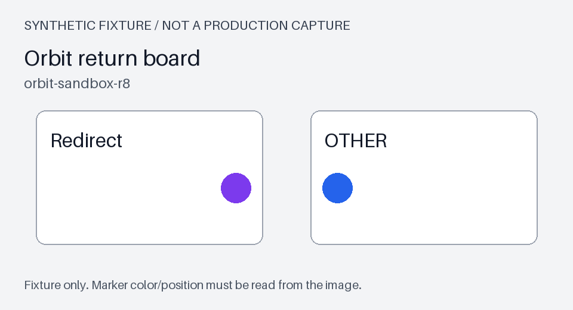

### q-heldout-005

OAUTH_CALLBACK_52 在 orbit-sandbox-r8 最后验证允许哪个回调路径，是否包括其他路径？

类别：fact；核图要求：False；预期状态：completed。
允许范围：h-timezone, h-auth, h-index, h-table, h-route, h-reconcile, h-audit, h-heartbeat。

- 参考事实：仅精确允许 /oidc/return；未扩大到其他路径，范围 orbit-sandbox-r8。 支持：h-auth-m3

拟定最小证据集合：[["h-auth-m3"]]

- [ ] 题意、等价答案与必要限定已复核
- [ ] 证据充分性、替代证据或不可回答原因已复核
- [ ] 若涉及图片，已对照原图检查颜色、位置与区域

复核者 / 日期 / 修改理由：待填写。

### q-heldout-006

OAUTH_CALLBACK_52 的故障、通配建议、实际修订与验证结论分别是什么？请保留环境限定。

类别：context；核图要求：False；预期状态：completed。
允许范围：h-timezone, h-auth, h-index, h-table, h-route, h-reconcile, h-audit, h-heartbeat。

- 参考事实：合成事件 OAUTH_CALLBACK_52：orbit-sandbox-r8 的登录回跳被拒绝，配置中仍保留旧路径。域名均为不可用的合成占位域名。 支持：h-auth-m0
- 参考事实：初步建议给整个路径加通配放行；该建议没有审批和执行记录。 支持：h-auth-m1
- 参考事实：修订只精确放行 https://orbit.example.invalid/oidc/return，不扩大到其他路径；测试使用合成应用身份。 支持：h-auth-m2
- 参考事实：合成验证单 HV-A02：orbit-sandbox-r8 只允许 /oidc/return 的精确回跳，指定合成回调样例通过；不包含生产应用或真实凭据。 支持：h-auth-m3

拟定最小证据集合：[["h-auth-m0", "h-auth-m1", "h-auth-m2", "h-auth-m3"]]

- [ ] 题意、等价答案与必要限定已复核
- [ ] 证据充分性、替代证据或不可回答原因已复核
- [ ] 若涉及图片，已对照原图检查颜色、位置与区域

复核者 / 日期 / 修改理由：待填写。

### q-heldout-007

请核对 Orbit return board 中 Redirect 卡片的圆点颜色及其在卡片内的左右位置。

类别：visual；核图要求：True；预期状态：completed。
允许范围：h-timezone, h-auth, h-index, h-table, h-route, h-reconcile, h-audit, h-heartbeat。

- 参考事实：Redirect卡片圆点为紫色。 支持：h-auth-panel
- 参考事实：圆点位于卡片右端。 支持：h-auth-panel

拟定最小证据集合：[["h-auth-panel"]]

图片真值（作者参数，待视觉复核）：{"evidence_id": "h-auth-panel", "label": "Redirect", "card_bbox_xyxy": [60, 185, 440, 410], "marker_bbox_xyxy": [370, 290, 421, 341], "marker_center_xy": [395, 315], "color": "purple", "rgb_hex": "#7c3aed", "side": "right"}

- [ ] 题意、等价答案与必要限定已复核
- [ ] 证据充分性、替代证据或不可回答原因已复核
- [ ] 若涉及图片，已对照原图检查颜色、位置与区域

复核者 / 日期 / 修改理由：待填写。

### q-heldout-008

Orbit 生产域名的回调放行测试结果是什么？

类别：unanswerable；核图要求：False；预期状态：insufficient。
允许范围：h-timezone, h-auth, h-index, h-table, h-route, h-reconcile, h-audit, h-heartbeat。

不可回答依据：生产域名及其测试结果均未给出，不能把合成应用的通过记录外推。

- [ ] 题意、等价答案与必要限定已复核
- [ ] 证据充分性、替代证据或不可回答原因已复核
- [ ] 若涉及图片，已对照原图检查颜色、位置与区域

复核者 / 日期 / 修改理由：待填写。

## h-index / heldout / index-alias

**h-index-m0**（回复：无）

合成事件 INDEX_ALIAS_64：alder-qa-r9 的手册查询仍命中旧索引，别名和正文映射未同时更新。

**h-index-m1**（回复：h-index-m0）

最初有人建议删除全部索引后重建；没有授权或执行记录，不能认定为实际处理。

**h-index-m2**（回复：h-index-m1）

修订只原子切换 manuals_active 到 manuals_r9，并把正文映射设为 body_text；不删除其他索引。

**h-index-m3**（回复：h-index-m2）

合成验证单 HV-I03：alder-qa-r9 的 manuals_active 指向 manuals_r9，正文使用 body_text，样例 DOC-Q17 可被检索到；不报告准确率。

**h-index-m4**（回复：h-index-m3）

Alder index board 为索引切换合成面板，Alias 卡片圆点的颜色和位置需读取原图。

**h-index-m5**（回复：无）

旧环境 alder-qa-r7 的 manuals_active 指向 manuals_r7，正文为 content；旧记录不能替代 r9 映射。

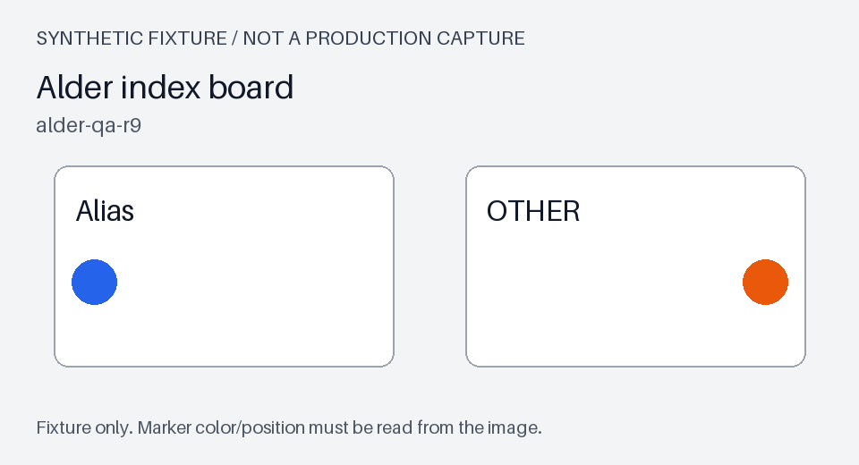

### q-heldout-009

INDEX_ALIAS_64 在 alder-qa-r9 验证后的活动索引和正文字段分别是什么？

类别：fact；核图要求：False；预期状态：completed。
允许范围：h-timezone, h-auth, h-index, h-table, h-route, h-reconcile, h-audit, h-heartbeat。

- 参考事实：manuals_active 指向 manuals_r9，正文字段为 body_text；仅验证 alder-qa-r9。 支持：h-index-m3

拟定最小证据集合：[["h-index-m3"]]

- [ ] 题意、等价答案与必要限定已复核
- [ ] 证据充分性、替代证据或不可回答原因已复核
- [ ] 若涉及图片，已对照原图检查颜色、位置与区域

复核者 / 日期 / 修改理由：待填写。

### q-heldout-010

请串起 INDEX_ALIAS_64 的旧索引现象、未执行建议、实际切换及检索验证，说明哪些操作没有执行。

类别：context；核图要求：False；预期状态：completed。
允许范围：h-timezone, h-auth, h-index, h-table, h-route, h-reconcile, h-audit, h-heartbeat。

- 参考事实：合成事件 INDEX_ALIAS_64：alder-qa-r9 的手册查询仍命中旧索引，别名和正文映射未同时更新。 支持：h-index-m0
- 参考事实：最初有人建议删除全部索引后重建；没有授权或执行记录，不能认定为实际处理。 支持：h-index-m1
- 参考事实：修订只原子切换 manuals_active 到 manuals_r9，并把正文映射设为 body_text；不删除其他索引。 支持：h-index-m2
- 参考事实：合成验证单 HV-I03：alder-qa-r9 的 manuals_active 指向 manuals_r9，正文使用 body_text，样例 DOC-Q17 可被检索到；不报告准确率。 支持：h-index-m3

拟定最小证据集合：[["h-index-m0", "h-index-m1", "h-index-m2", "h-index-m3"]]

- [ ] 题意、等价答案与必要限定已复核
- [ ] 证据充分性、替代证据或不可回答原因已复核
- [ ] 若涉及图片，已对照原图检查颜色、位置与区域

复核者 / 日期 / 修改理由：待填写。

### q-heldout-011

Alder index board 上 Alias 卡片的圆点呈什么颜色，在卡片左端还是右端？

类别：visual；核图要求：True；预期状态：completed。
允许范围：h-timezone, h-auth, h-index, h-table, h-route, h-reconcile, h-audit, h-heartbeat。

- 参考事实：Alias卡片圆点为蓝色。 支持：h-index-panel
- 参考事实：圆点位于卡片左端。 支持：h-index-panel

拟定最小证据集合：[["h-index-panel"]]

图片真值（作者参数，待视觉复核）：{"evidence_id": "h-index-panel", "label": "Alias", "card_bbox_xyxy": [60, 185, 440, 410], "marker_bbox_xyxy": [80, 290, 131, 341], "marker_center_xy": [105, 315], "color": "blue", "rgb_hex": "#2563eb", "side": "left"}

- [ ] 题意、等价答案与必要限定已复核
- [ ] 证据充分性、替代证据或不可回答原因已复核
- [ ] 若涉及图片，已对照原图检查颜色、位置与区域

复核者 / 日期 / 修改理由：待填写。

### q-heldout-012

只依据当前允许的资料，alder-qa-r9 手册索引的正文字段叫什么？

类别：unanswerable；核图要求：False；预期状态：insufficient。
允许范围：h-timezone, h-auth, h-table, h-route, h-reconcile, h-audit, h-heartbeat。

不可回答依据：本题允许范围不含 Alder 情景，离线标签中的字段不能传给模型或当作本次引用。

- [ ] 题意、等价答案与必要限定已复核
- [ ] 证据充分性、替代证据或不可回答原因已复核
- [ ] 若涉及图片，已对照原图检查颜色、位置与区域

复核者 / 日期 / 修改理由：待填写。

## h-table / heldout / merged-table

**h-table-m0**（回复：无）

合成事件 TABLE_MERGE_75：linden-test-r4 导出的本地表格出现合并单元格重复展开，行数与样例不符。

**h-table-m1**（回复：h-table-m0）

最初建议对所有空格做前向填充；该建议未通过合并区域边界检查。

**h-table-m2**（回复：h-table-m1）

修订对 layout_rev=12 使用 merged_cell_policy=anchor_only，只保留合并区域锚点，不对普通空格统一填充。

**h-table-m3**（回复：h-table-m2）

合成验证单 HV-M04：linden-test-r4 的 layout_rev=12 使用 anchor_only，样例 TBL-S7 导出7行；未验证扫描PDF或其他布局版本。

**h-table-m4**（回复：h-table-m3）

Linden table board 是本地表格的合成面板，Anchor 卡片内圆点的视觉信息保存在附件中。

**h-table-m5**（回复：无）

旧环境 linden-test-r2 使用 forward_fill 且导出9行，不是 r4 的边界验证结果。

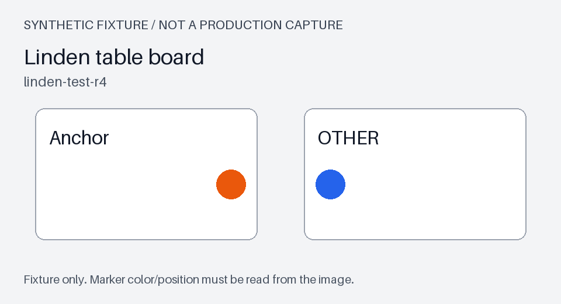

### q-heldout-013

TABLE_MERGE_75 在 linden-test-r4 采用哪种合并策略，TBL-S7 的验证行数是多少？

类别：fact；核图要求：False；预期状态：completed。
允许范围：h-timezone, h-auth, h-index, h-table, h-route, h-reconcile, h-audit, h-heartbeat。

- 参考事实：layout_rev=12 使用 anchor_only，TBL-S7 导出7行；范围 linden-test-r4。 支持：h-table-m3

拟定最小证据集合：[["h-table-m3"]]

- [ ] 题意、等价答案与必要限定已复核
- [ ] 证据充分性、替代证据或不可回答原因已复核
- [ ] 若涉及图片，已对照原图检查颜色、位置与区域

复核者 / 日期 / 修改理由：待填写。

### q-heldout-014

TABLE_MERGE_75 从重复展开到验证修复经历了哪些判断？请区分普通空格、合并区域及已覆盖布局。

类别：context；核图要求：False；预期状态：completed。
允许范围：h-timezone, h-auth, h-index, h-table, h-route, h-reconcile, h-audit, h-heartbeat。

- 参考事实：合成事件 TABLE_MERGE_75：linden-test-r4 导出的本地表格出现合并单元格重复展开，行数与样例不符。 支持：h-table-m0
- 参考事实：最初建议对所有空格做前向填充；该建议未通过合并区域边界检查。 支持：h-table-m1
- 参考事实：修订对 layout_rev=12 使用 merged_cell_policy=anchor_only，只保留合并区域锚点，不对普通空格统一填充。 支持：h-table-m2
- 参考事实：合成验证单 HV-M04：linden-test-r4 的 layout_rev=12 使用 anchor_only，样例 TBL-S7 导出7行；未验证扫描PDF或其他布局版本。 支持：h-table-m3

拟定最小证据集合：[["h-table-m0", "h-table-m1", "h-table-m2", "h-table-m3"]]

- [ ] 题意、等价答案与必要限定已复核
- [ ] 证据充分性、替代证据或不可回答原因已复核
- [ ] 若涉及图片，已对照原图检查颜色、位置与区域

复核者 / 日期 / 修改理由：待填写。

### q-heldout-015

从 Linden table board 原图判断 Anchor 卡片的圆点颜色，以及它在卡片的左端还是右端。

类别：visual；核图要求：True；预期状态：completed。
允许范围：h-timezone, h-auth, h-index, h-table, h-route, h-reconcile, h-audit, h-heartbeat。

- 参考事实：Anchor卡片圆点为橙色。 支持：h-table-panel
- 参考事实：圆点位于卡片右端。 支持：h-table-panel

拟定最小证据集合：[["h-table-panel"]]

图片真值（作者参数，待视觉复核）：{"evidence_id": "h-table-panel", "label": "Anchor", "card_bbox_xyxy": [60, 185, 440, 410], "marker_bbox_xyxy": [370, 290, 421, 341], "marker_center_xy": [395, 315], "color": "orange", "rgb_hex": "#ea580c", "side": "right"}

- [ ] 题意、等价答案与必要限定已复核
- [ ] 证据充分性、替代证据或不可回答原因已复核
- [ ] 若涉及图片，已对照原图检查颜色、位置与区域

复核者 / 日期 / 修改理由：待填写。

### q-heldout-016

扫描PDF混合版式在 layout_rev=18 下采用这一策略的实测导出行数是多少？

类别：unanswerable；核图要求：False；预期状态：insufficient。
允许范围：h-timezone, h-auth, h-index, h-table, h-route, h-reconcile, h-audit, h-heartbeat。

不可回答依据：记录明确未验证扫描PDF或其他布局，不能提供 layout_rev=18 的实测行数。

- [ ] 题意、等价答案与必要限定已复核
- [ ] 证据充分性、替代证据或不可回答原因已复核
- [ ] 若涉及图片，已对照原图检查颜色、位置与区域

复核者 / 日期 / 修改理由：待填写。

## h-route / heldout / notification-routing

**h-route-m0**（回复：无）

合成事件 NOTIFY_DUP_86：iris-qa-r7 对同一事件重复通知，测试记录没有按团队区分去重范围。

**h-route-m1**（回复：h-route-m0）

最初建议关闭全部通知通道；该建议未执行，也不能用来证明去重成功。

**h-route-m2**（回复：h-route-m1）

修订设置 route_key=team_id:event_type，并在事件ID维度保留120秒去重窗口，不能跨团队共用去重键。

**h-route-m3**（回复：h-route-m2）

合成验证单 HV-N05：iris-qa-r7 按 team_id:event_type 分路，事件ID去重窗口120秒，单团队的同一合成事件只投递一次；未测试跨区域复制。

**h-route-m4**（回复：h-route-m3）

Iris route board 是路由合成面板，Route 卡片圆点的颜色与位置只在图片中展示。

**h-route-m5**（回复：无）

旧环境 iris-qa-r5 使用30秒窗口且没有团队维度；不是 r7 的多团队修订记录。

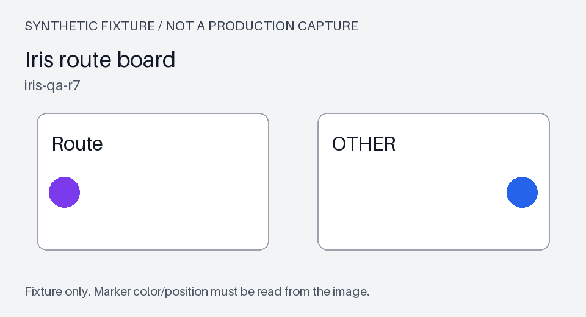

### q-heldout-017

NOTIFY_DUP_86 在 iris-qa-r7 最后验证的路由键与去重窗口是什么？

类别：fact；核图要求：False；预期状态：completed。
允许范围：h-timezone, h-auth, h-index, h-table, h-route, h-reconcile, h-audit, h-heartbeat。

- 参考事实：route_key=team_id:event_type，事件ID去重窗口120秒；只验证 iris-qa-r7 单团队合成事件。 支持：h-route-m3

拟定最小证据集合：[["h-route-m3"]]

- [ ] 题意、等价答案与必要限定已复核
- [ ] 证据充分性、替代证据或不可回答原因已复核
- [ ] 若涉及图片，已对照原图检查颜色、位置与区域

复核者 / 日期 / 修改理由：待填写。

### q-heldout-018

NOTIFY_DUP_86 为什么不能用关闭通道代替修复？请结合起因、实际去重范围和验证边界说明。

类别：context；核图要求：False；预期状态：completed。
允许范围：h-timezone, h-auth, h-index, h-table, h-route, h-reconcile, h-audit, h-heartbeat。

- 参考事实：合成事件 NOTIFY_DUP_86：iris-qa-r7 对同一事件重复通知，测试记录没有按团队区分去重范围。 支持：h-route-m0
- 参考事实：最初建议关闭全部通知通道；该建议未执行，也不能用来证明去重成功。 支持：h-route-m1
- 参考事实：修订设置 route_key=team_id:event_type，并在事件ID维度保留120秒去重窗口，不能跨团队共用去重键。 支持：h-route-m2
- 参考事实：合成验证单 HV-N05：iris-qa-r7 按 team_id:event_type 分路，事件ID去重窗口120秒，单团队的同一合成事件只投递一次；未测试跨区域复制。 支持：h-route-m3

拟定最小证据集合：[["h-route-m0", "h-route-m1", "h-route-m2", "h-route-m3"]]

- [ ] 题意、等价答案与必要限定已复核
- [ ] 证据充分性、替代证据或不可回答原因已复核
- [ ] 若涉及图片，已对照原图检查颜色、位置与区域

复核者 / 日期 / 修改理由：待填写。

### q-heldout-019

Iris route board 中 Route 卡片圆点是什么颜色，处在卡片哪一端？

类别：visual；核图要求：True；预期状态：completed。
允许范围：h-timezone, h-auth, h-index, h-table, h-route, h-reconcile, h-audit, h-heartbeat。

- 参考事实：Route卡片圆点为紫色。 支持：h-route-panel
- 参考事实：圆点位于卡片左端。 支持：h-route-panel

拟定最小证据集合：[["h-route-panel"]]

图片真值（作者参数，待视觉复核）：{"evidence_id": "h-route-panel", "label": "Route", "card_bbox_xyxy": [60, 185, 440, 410], "marker_bbox_xyxy": [80, 290, 131, 341], "marker_center_xy": [105, 315], "color": "purple", "rgb_hex": "#7c3aed", "side": "left"}

- [ ] 题意、等价答案与必要限定已复核
- [ ] 证据充分性、替代证据或不可回答原因已复核
- [ ] 若涉及图片，已对照原图检查颜色、位置与区域

复核者 / 日期 / 修改理由：待填写。

### q-heldout-020

iris 生产环境跨区域复制后，同一事件的实际投递次数是多少？

类别：unanswerable；核图要求：False；预期状态：insufficient。
允许范围：h-timezone, h-auth, h-index, h-table, h-route, h-reconcile, h-audit, h-heartbeat。

不可回答依据：没有生产跨区域复制测试，不能将单团队样例的次数外推。

- [ ] 题意、等价答案与必要限定已复核
- [ ] 证据充分性、替代证据或不可回答原因已复核
- [ ] 若涉及图片，已对照原图检查颜色、位置与区域

复核者 / 日期 / 修改理由：待填写。

## h-reconcile / heldout / batch-reconciliation

**h-reconcile-m0**（回复：无）

合成事件 RECON_BATCH_97：quartz-sandbox-r6 合并两份不同版本合成台账，批次身份发生混淆；没有真实财务数据。

**h-reconcile-m1**（回复：h-reconcile-m0）

最初建议自动抵消全部差异；该建议被搁置，没有记账或转账执行记录。

**h-reconcile-m2**（回复：h-reconcile-m1）

修订以 source_file_id:statement_date 标识批次，先执行 dry_run=true 的结构核对，不自动抵消差异。

**h-reconcile-m3**（回复：h-reconcile-m2）

合成验证单 HV-R06：quartz-sandbox-r6 使用 batch_key=source_file_id:statement_date、dry_run=true，两份指定合成文件的行身份匹配；不证明真实账目正确。

**h-reconcile-m4**（回复：h-reconcile-m3）

Quartz ledger board 是结构核对合成面板，Ledger 卡片内圆点需要在原图中定位。

**h-reconcile-m5**（回复：无）

旧环境 quartz-sandbox-r3 用文件名充当批次键且 dry_run=false；不适用于 r6 的合成核对。

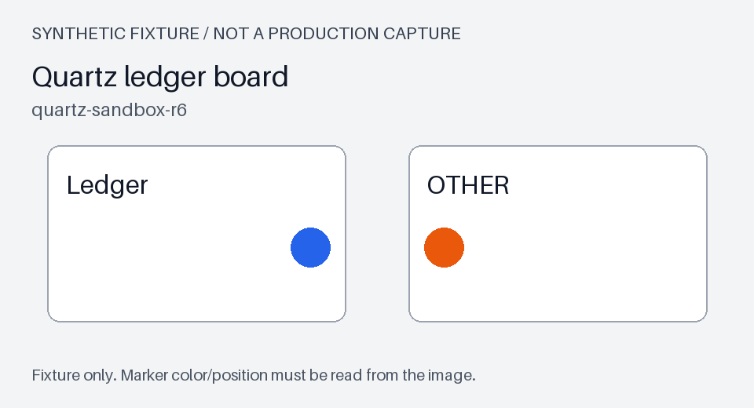

### q-heldout-021

RECON_BATCH_97 在 quartz-sandbox-r6 使用什么批次键，核对是否为 dry run？

类别：fact；核图要求：False；预期状态：completed。
允许范围：h-timezone, h-auth, h-index, h-table, h-route, h-reconcile, h-audit, h-heartbeat。

- 参考事实：batch_key=source_file_id:statement_date，dry_run=true；仅核对 quartz-sandbox-r6 指定合成文件。 支持：h-reconcile-m3

拟定最小证据集合：[["h-reconcile-m3"]]

- [ ] 题意、等价答案与必要限定已复核
- [ ] 证据充分性、替代证据或不可回答原因已复核
- [ ] 若涉及图片，已对照原图检查颜色、位置与区域

复核者 / 日期 / 修改理由：待填写。

### q-heldout-022

请说明 RECON_BATCH_97 的批次混淆、未执行建议、结构核对修订及结论边界，勿把合成核对当成真实记账。

类别：context；核图要求：False；预期状态：completed。
允许范围：h-timezone, h-auth, h-index, h-table, h-route, h-reconcile, h-audit, h-heartbeat。

- 参考事实：合成事件 RECON_BATCH_97：quartz-sandbox-r6 合并两份不同版本合成台账，批次身份发生混淆；没有真实财务数据。 支持：h-reconcile-m0
- 参考事实：最初建议自动抵消全部差异；该建议被搁置，没有记账或转账执行记录。 支持：h-reconcile-m1
- 参考事实：修订以 source_file_id:statement_date 标识批次，先执行 dry_run=true 的结构核对，不自动抵消差异。 支持：h-reconcile-m2
- 参考事实：合成验证单 HV-R06：quartz-sandbox-r6 使用 batch_key=source_file_id:statement_date、dry_run=true，两份指定合成文件的行身份匹配；不证明真实账目正确。 支持：h-reconcile-m3

拟定最小证据集合：[["h-reconcile-m0", "h-reconcile-m1", "h-reconcile-m2", "h-reconcile-m3"]]

- [ ] 题意、等价答案与必要限定已复核
- [ ] 证据充分性、替代证据或不可回答原因已复核
- [ ] 若涉及图片，已对照原图检查颜色、位置与区域

复核者 / 日期 / 修改理由：待填写。

### q-heldout-023

Quartz ledger board 原图里 Ledger 卡片的圆点是哪种颜色，靠左还是靠右？

类别：visual；核图要求：True；预期状态：completed。
允许范围：h-timezone, h-auth, h-index, h-table, h-route, h-reconcile, h-audit, h-heartbeat。

- 参考事实：Ledger卡片圆点为蓝色。 支持：h-reconcile-panel
- 参考事实：圆点位于卡片右端。 支持：h-reconcile-panel

拟定最小证据集合：[["h-reconcile-panel"]]

图片真值（作者参数，待视觉复核）：{"evidence_id": "h-reconcile-panel", "label": "Ledger", "card_bbox_xyxy": [60, 185, 440, 410], "marker_bbox_xyxy": [370, 290, 421, 341], "marker_center_xy": [395, 315], "color": "blue", "rgb_hex": "#2563eb", "side": "right"}

- [ ] 题意、等价答案与必要限定已复核
- [ ] 证据充分性、替代证据或不可回答原因已复核
- [ ] 若涉及图片，已对照原图检查颜色、位置与区域

复核者 / 日期 / 修改理由：待填写。

### q-heldout-024

quartz 生产环境最近一批实际对账的差异行数是多少？

类别：unanswerable；核图要求：False；预期状态：insufficient。
允许范围：h-timezone, h-auth, h-index, h-table, h-route, h-reconcile, h-audit, h-heartbeat。

不可回答依据：只有合成文件的结构核对，没有生产批次和实际差异行数。

- [ ] 题意、等价答案与必要限定已复核
- [ ] 证据充分性、替代证据或不可回答原因已复核
- [ ] 若涉及图片，已对照原图检查颜色、位置与区域

复核者 / 日期 / 修改理由：待填写。

## h-audit / heldout / attachment-lifecycle

**h-audit-m0**（回复：无）

合成事件 AUDIT_KEEP_108：willow-test-r3 的审计附件在清理后仍被旧目录链接引用，附件与目录状态未同步。

**h-audit-m1**（回复：h-audit-m0）

最初建议把所有消息与附件一起立即删除；该建议没有执行记录。

**h-audit-m2**（回复：h-audit-m1）

修订仅针对测试审计附件：保留27天后先标记 soft_deleted，再移除目录链接；不涉及聊天消息或客户日志的保存政策。

**h-audit-m3**（回复：h-audit-m2）

合成验证单 HV-K07：willow-test-r3 的审计附件采用 retention_days=27、soft_deleted=true，指定过期附件的目录链接已移除；不是法律或客户政策结论。

**h-audit-m4**（回复：h-audit-m3）

Willow archive board 是附件生命周期合成面板，Archive 卡片的圆点属性只存在于原图。

**h-audit-m5**（回复：无）

旧环境 willow-test-r1 的附件保留45天且直接移除文件；旧配置不是 r3 的生命周期验证。

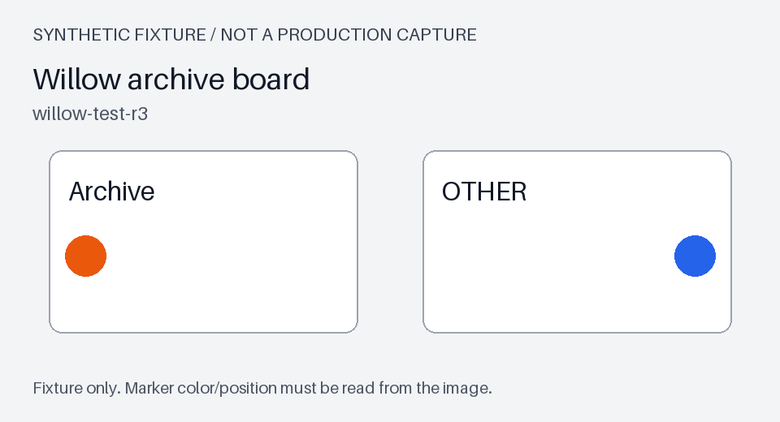

### q-heldout-025

AUDIT_KEEP_108 在 willow-test-r3 验证的附件保留天数及删除标记是什么？

类别：fact；核图要求：False；预期状态：completed。
允许范围：h-timezone, h-auth, h-index, h-table, h-route, h-reconcile, h-audit, h-heartbeat。

- 参考事实：retention_days=27，先标记 soft_deleted；仅适用于 willow-test-r3 测试审计附件。 支持：h-audit-m3

拟定最小证据集合：[["h-audit-m3"]]

- [ ] 题意、等价答案与必要限定已复核
- [ ] 证据充分性、替代证据或不可回答原因已复核
- [ ] 若涉及图片，已对照原图检查颜色、位置与区域

复核者 / 日期 / 修改理由：待填写。

### q-heldout-026

AUDIT_KEEP_108 最初如何暴露链接问题？请说明未执行建议、最终处理顺序及适用对象，避免泛化到其他资料。

类别：context；核图要求：False；预期状态：completed。
允许范围：h-timezone, h-auth, h-index, h-table, h-route, h-reconcile, h-audit, h-heartbeat。

- 参考事实：合成事件 AUDIT_KEEP_108：willow-test-r3 的审计附件在清理后仍被旧目录链接引用，附件与目录状态未同步。 支持：h-audit-m0
- 参考事实：最初建议把所有消息与附件一起立即删除；该建议没有执行记录。 支持：h-audit-m1
- 参考事实：修订仅针对测试审计附件：保留27天后先标记 soft_deleted，再移除目录链接；不涉及聊天消息或客户日志的保存政策。 支持：h-audit-m2
- 参考事实：合成验证单 HV-K07：willow-test-r3 的审计附件采用 retention_days=27、soft_deleted=true，指定过期附件的目录链接已移除；不是法律或客户政策结论。 支持：h-audit-m3

拟定最小证据集合：[["h-audit-m0", "h-audit-m1", "h-audit-m2", "h-audit-m3"]]

- [ ] 题意、等价答案与必要限定已复核
- [ ] 证据充分性、替代证据或不可回答原因已复核
- [ ] 若涉及图片，已对照原图检查颜色、位置与区域

复核者 / 日期 / 修改理由：待填写。

### q-heldout-027

Willow archive board 的 Archive 卡片中，圆点为何种颜色，位于卡片内左端还是右端？

类别：visual；核图要求：True；预期状态：completed。
允许范围：h-timezone, h-auth, h-index, h-table, h-route, h-reconcile, h-audit, h-heartbeat。

- 参考事实：Archive卡片圆点为橙色。 支持：h-audit-panel
- 参考事实：圆点位于卡片左端。 支持：h-audit-panel

拟定最小证据集合：[["h-audit-panel"]]

图片真值（作者参数，待视觉复核）：{"evidence_id": "h-audit-panel", "label": "Archive", "card_bbox_xyxy": [60, 185, 440, 410], "marker_bbox_xyxy": [80, 290, 131, 341], "marker_center_xy": [105, 315], "color": "orange", "rgb_hex": "#ea580c", "side": "left"}

- [ ] 题意、等价答案与必要限定已复核
- [ ] 证据充分性、替代证据或不可回答原因已复核
- [ ] 若涉及图片，已对照原图检查颜色、位置与区域

复核者 / 日期 / 修改理由：待填写。

### q-heldout-028

真实客户的聊天日志保存期限是多少天？

类别：unanswerable；核图要求：False；预期状态：insufficient。
允许范围：h-timezone, h-auth, h-index, h-table, h-route, h-reconcile, h-audit, h-heartbeat。

不可回答依据：附件测试配置不是客户聊天日志政策，资料没有给出所问期限。

- [ ] 题意、等价答案与必要限定已复核
- [ ] 证据充分性、替代证据或不可回答原因已复核
- [ ] 若涉及图片，已对照原图检查颜色、位置与区域

复核者 / 日期 / 修改理由：待填写。

## h-heartbeat / heldout / websocket-heartbeat

**h-heartbeat-m0**（回复：无）

合成事件 WS_IDLE_119：spruce-qa-r10 的长连接在静默样例中关闭，客户端没有发送心跳。

**h-heartbeat-m1**（回复：h-heartbeat-m0）

最初建议固定15秒重连而不发心跳；这项建议没有执行或稳定性验证。

**h-heartbeat-m2**（回复：h-heartbeat-m1）

修订为 heartbeat_interval=11秒、miss_threshold=3，并把心跳失败与普通业务空闲分开处理。

**h-heartbeat-m3**（回复：h-heartbeat-m2）

合成验证单 HV-W08：spruce-qa-r10 使用 heartbeat_interval=11秒、miss_threshold=3，指定静默样例不再因缺少心跳关闭；不报告可用率或生产丢包率。

**h-heartbeat-m4**（回复：h-heartbeat-m3）

Spruce socket board 是长连接合成面板，Socket 卡片圆点的颜色及位置应由原图核查。

**h-heartbeat-m5**（回复：无）

旧环境 spruce-qa-r8 使用20秒心跳、miss_threshold=2，不能替代 r10 的指定样例。

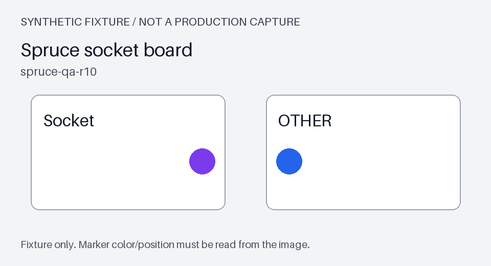

### q-heldout-029

WS_IDLE_119 在 spruce-qa-r10 验证通过的心跳间隔和漏失阈值分别是多少？

类别：fact；核图要求：False；预期状态：completed。
允许范围：h-timezone, h-auth, h-index, h-table, h-route, h-reconcile, h-audit, h-heartbeat。

- 参考事实：heartbeat_interval=11秒、miss_threshold=3；范围 spruce-qa-r10 指定静默样例。 支持：h-heartbeat-m3

拟定最小证据集合：[["h-heartbeat-m3"]]

- [ ] 题意、等价答案与必要限定已复核
- [ ] 证据充分性、替代证据或不可回答原因已复核
- [ ] 若涉及图片，已对照原图检查颜色、位置与区域

复核者 / 日期 / 修改理由：待填写。

### q-heldout-030

请梳理 WS_IDLE_119 的静默断连、早期重连建议、心跳修订及验证所能支持的范围。

类别：context；核图要求：False；预期状态：completed。
允许范围：h-timezone, h-auth, h-index, h-table, h-route, h-reconcile, h-audit, h-heartbeat。

- 参考事实：合成事件 WS_IDLE_119：spruce-qa-r10 的长连接在静默样例中关闭，客户端没有发送心跳。 支持：h-heartbeat-m0
- 参考事实：最初建议固定15秒重连而不发心跳；这项建议没有执行或稳定性验证。 支持：h-heartbeat-m1
- 参考事实：修订为 heartbeat_interval=11秒、miss_threshold=3，并把心跳失败与普通业务空闲分开处理。 支持：h-heartbeat-m2
- 参考事实：合成验证单 HV-W08：spruce-qa-r10 使用 heartbeat_interval=11秒、miss_threshold=3，指定静默样例不再因缺少心跳关闭；不报告可用率或生产丢包率。 支持：h-heartbeat-m3

拟定最小证据集合：[["h-heartbeat-m0", "h-heartbeat-m1", "h-heartbeat-m2", "h-heartbeat-m3"]]

- [ ] 题意、等价答案与必要限定已复核
- [ ] 证据充分性、替代证据或不可回答原因已复核
- [ ] 若涉及图片，已对照原图检查颜色、位置与区域

复核者 / 日期 / 修改理由：待填写。

### q-heldout-031

Spruce socket board 上 Socket 卡片的圆点是什么颜色，在卡片左端还是右端？

类别：visual；核图要求：True；预期状态：completed。
允许范围：h-timezone, h-auth, h-index, h-table, h-route, h-reconcile, h-audit, h-heartbeat。

- 参考事实：Socket卡片圆点为紫色。 支持：h-heartbeat-panel
- 参考事实：圆点位于卡片右端。 支持：h-heartbeat-panel

拟定最小证据集合：[["h-heartbeat-panel"]]

图片真值（作者参数，待视觉复核）：{"evidence_id": "h-heartbeat-panel", "label": "Socket", "card_bbox_xyxy": [60, 185, 440, 410], "marker_bbox_xyxy": [370, 290, 421, 341], "marker_center_xy": [395, 315], "color": "purple", "rgb_hex": "#7c3aed", "side": "right"}

- [ ] 题意、等价答案与必要限定已复核
- [ ] 证据充分性、替代证据或不可回答原因已复核
- [ ] 若涉及图片，已对照原图检查颜色、位置与区域

复核者 / 日期 / 修改理由：待填写。

### q-heldout-032

spruce 生产环境实际网络丢包率是多少？

类别：unanswerable；核图要求：False；预期状态：insufficient。
允许范围：h-timezone, h-auth, h-index, h-table, h-route, h-reconcile, h-audit, h-heartbeat。

不可回答依据：没有生产丢包统计、采样窗口或负载记录，不能由心跳配置推算。

- [ ] 题意、等价答案与必要限定已复核
- [ ] 证据充分性、替代证据或不可回答原因已复核
- [ ] 若涉及图片，已对照原图检查颜色、位置与区域

复核者 / 日期 / 修改理由：待填写。
