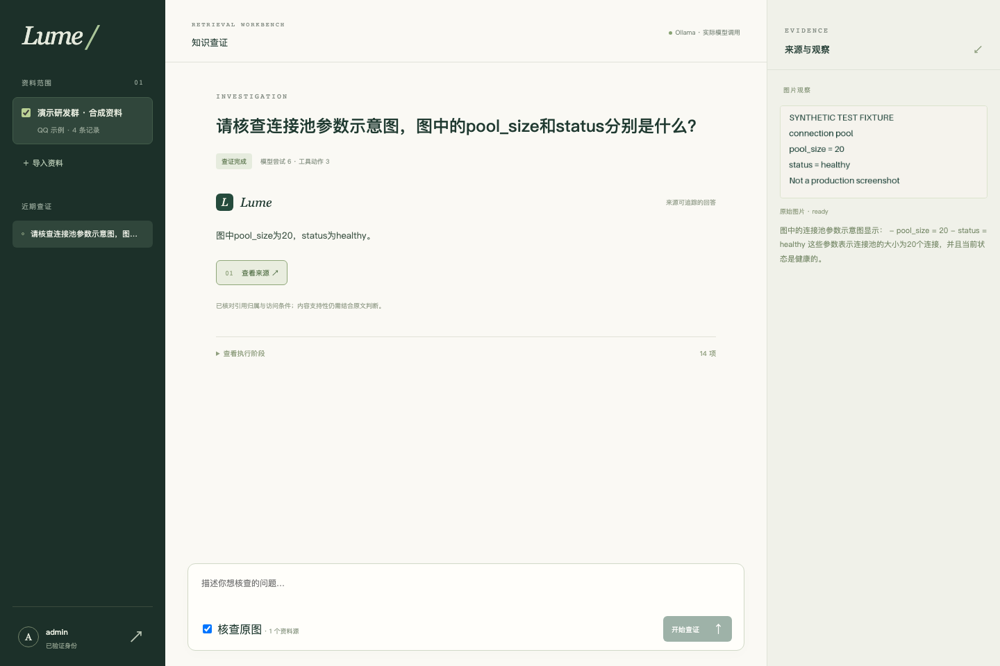

# 真实模型联调复现说明

本说明对应`scripts/validate_real_models.py`。执行计划见[real-model-validation-plan.md](real-model-validation-plan.md)。程序验证使用四条固定人工合成消息及一张合成图片，不读取已有聊天资料，不调用QQ。

## 准备与执行

本轮使用macOS arm64、16 GB统一内存和Ollama 0.40.11。为限制并发占用，验证服务只监听本机独立端口，最多加载一个模型，不影响默认11434端口配置。

```bash
OLLAMA_HOST=127.0.0.1:11435 OLLAMA_NO_CLOUD=1 \
OLLAMA_MAX_LOADED_MODELS=1 OLLAMA_NUM_PARALLEL=1 \
OLLAMA_CONTEXT_LENGTH=4096 ollama serve
```

在其他终端下载既有适配器配置指定的模型。下载与推理分开；下载成功不表示模型推理或任务验收成功。权重保留在Ollama自身模型目录，不加入源码归档。

```bash
OLLAMA_HOST=127.0.0.1:11435 ollama pull embeddinggemma
OLLAMA_HOST=127.0.0.1:11435 ollama pull qwen3:4b
OLLAMA_HOST=127.0.0.1:11435 ollama pull qwen2.5vl:3b
```

使用独立测试数据库连接，并将结果写入不同文件。优先通过环境设置连接串，避免将密码直接写入可见命令；不要将连接串提交Git。脚本只向本机Ollama发送合成内容，不接受远程模型地址。

```bash
uv run --frozen python scripts/validate_real_models.py \
  --ollama-url http://127.0.0.1:11435 \
  --output ../outputs/lume-real-model/run-01-baseline.json
```

运行前设置`LUME_TEST_DATABASE_URL`，需具备创建schema及使用vector扩展权限。脚本创建随机`modelcheck_*` schema和内存令牌，结束时仅移除该schema与临时图片目录。不会初始化、重建或清空public表。不要在企业生产数据库上执行实验。程序通过ASGI transport调用真实业务API函数，与真实数据库和Ollama通信；这不是浏览器或公网HTTP部署验收。

默认沿用90秒任务期限。若排障需要用`--task-timeout`改变期限，须单独命名结果并披露；不得覆盖默认配置下的失败，或据此声称默认期限已经达标。

## 记录与判读

结果包含源码提交、工作树状态、验证脚本SHA256、选中权重的digest与量化信息、配置身份、向量维数及实际向量、结构化动作、图像观察、处理状态、任务轨迹、答案、引用、依赖及清理状态。只记录模型最终结构化决策，不记录内部思维文本；不输出身份令牌和数据库连接串。

`status=returned`只表示该阶段函数返回。任务可能返回failed、limited或insufficient，必须结合终态判断。`workflow_checks`是预先固定的流程判据，不是准确率：向量返回、首次动作search、视觉返回、四条派生就绪、图片处理完成、文本答案发布、图片答案实际引用image_observation、无依据问题标为insufficient、临时schema清理。任一流程判据失败或调用异常时进程非零退出，报告仍保留。语义正确性另作人工对照，不能因JSON合法而判定。当前脚本对image_task显式提交require_image=true，其余两项false；这一配置写入各任务结果，前四轮普通模式记录不作同配置比较。

联调问题固定为：v1.8连接池故障的处理与复测；图中pool_size和status；资料未记录的v9.9显存容量。参考事实分别为pool_size由5改为20后复测恢复且仅明确适用于v1.8、图中20/healthy、无资料支持显存数字。第三项不能凭常识补造数值。模型输出与参考存在差异时，应记录差异；本脚本不是隐藏测试集，不能用于泛化效果结论。

## 2026-11-03实际结果

最终完整联调源码为[91482fa](https://github.com/xuhuilun/Lume/commit/91482faff7f104cce88b5e7eaceff1f0561f506b)，见[evidence/real-model/run-06-final.json](evidence/real-model/run-06-final.json)。开始时工作树干净。完整链路使用ASGI业务API、真实PostgreSQL/pgvector及实际Ollama推理；另一项浏览器验证使用独立API/worker进程和新建的临时数据库。

| 项目 | 实际结果 | 解释边界 |
| --- | --- | --- |
| EmbeddingGemma | BF16，768维非零有限向量 | 仅文本向量；不是原生图像向量 |
| qwen3:4b | Q4_K_M，实际生成检索词、动作和答案 | 不用DemoProvider回放替代 |
| qwen2.5vl:3b | Q4_K_M，实际识别合成图中的20/healthy | 单图调试，不是视觉准确率 |
| 后台派生 | 4条job均ready，实际OCR与描述写入索引 | 4条人工合成消息 |
| 文本任务 | completed，有本任务已读观察引用，模型尝试4/工具2/图像0 | 主要参数、环境与复测叙述与固定合成事实一致 |
| 核图任务 | completed，search→read_context→inspect_image→final；模型尝试6/工具3/图像1 | require_image=true；最终引用实际image_observation |
| 无依据任务 | insufficient，未补造GPU显存数字，模型尝试4/工具2/图像0 | 正文与不足状态一致，仅一条不可回答调试题 |
| 后端回归 | 33项通过、无跳过，4.26秒 | [JUnit](evidence/real-model/backend-regression-complete.xml)；套件耗时不是业务延迟 |
| 真实模型浏览器 | 1项通过、无跳过/重试失败 | [原始Playwright JSON](evidence/real-model/browser-real-model.json)；本次没有重跑旧3项Demo浏览器案例 |
| 静态与构建 | Ruff/格式、TypeScript/Vite、Prettier通过 | 不作为模型质量或生产验收 |

33项后端包含原25项及本阶段新增8项，涵盖生成目标集合、已读进度、空候选、核图要求、模型输入视图、发布拒绝和空视觉返回。它们不等于论文34个完整命名项目的逐项验收，不能用33/34计算覆盖率。

向量权重digest为85462619ee721b466c5927d109d4cb765861907d5417b9109caebc4e614679f1；Qwen3为359d7dd4bcdab3d86b87d73ac27966f4dbb9f5efdfcc75d34a8764a09474fae7；视觉权重为fb90415cde1ef08aa669ae74b082d49b158729b6db1ab183c941417d507e71a1。标签可变，复现需核对摘要；三种权重保留在本机Ollama目录，未提交Git。EmbeddingGemma模型元数据报告2048 tokens原生上限，不能因服务4096上下文配置就假设向量模型支持4096。

### 首次失败与修订轨迹

| 记录 | 实际观察 | 后续措施 |
| --- | --- | --- |
| run-01-baseline.json，1bb65a2 | 结构合法但初始编造inspect_image目标；3任务INVALID_TARGET | 状态相关动作/目标schema，明确ID类别 |
| run-02-constrained-actions.json，a65ced4 | 3任务重复search后limited | 非空候选先读原文 |
| run-03-read-before-search.json，8ab112d | 已读后仍重复search，3任务limited | 同一观察探测支持加入明确已完成阶段的提示 |
| run-04-progress-aware.json，7b0c31b | 都发布答案，但核图题跳过原图、拒答标记false | 该轮流程检查失败；图片派生/文件状态从模型消息视图移除，单一不足布尔字段，新增显式核图任务要求 |
| run-05-required-image.json，71279ef | 3任务按预设结果结束，核图有实际观察引用 | 保留原始结果；后续补空视觉返回拒绝 |
| run-06-final.json，91482fa | 9项流程判据全部满足，3任务分别completed/completed/insufficient | 当前完整联调记录 |

所有原始报告、think=false兼容探测及两个语义约束探测均保留在evidence/real-model。早期semantic-contract-probes只修改接口schema而没有同步提示中的schema，属于带混杂条件的排障尝试；后续coherent探测同步两者，仍出现把文件状态ready误作图中status的错误。它们是排障记录，不是消融实验，也不证明任何单项改动带来量化提升。

本次主执行者依据固定合成事实对照答案和观察，没有宣称完成独立人工标注或逐断言盲审。调试中多次使用了同样问题，因此它们必须从正式隐藏测试中排除。未执行真实QQ、企业资料、独立质量、负载、多并发或真实授权同步评价。

### 浏览器与清理

新增用例frontend/tests/real-model.spec.ts先核对服务provider=ollama，实际勾选“核查原图”，检查POST参数、已发布答案、图片观察引用、受控原图展示及退出后选项重置。截图为实际桌面/移动视图，已人工查看：



浏览器源码快照为d260086（与71279ef相同的业务实现，增加了该浏览器用例）；最终91482fa只额外拒绝空视觉返回。浏览器通过不是最后一版对全部浏览器场景的回归结论。

```bash
cd frontend
LUME_UI_REAL_MODELS=1 LUME_UI_BASE_URL=http://127.0.0.1:8000 \
LUME_UI_TOKEN_FILE=../.runtime/admin-token \
  npx playwright test tests/real-model.spec.ts
```

需自行启动已用相同固定权重完成派生的API和worker。未显式启用时本用例跳过，不能把跳过视为通过。报告将令牌字面值替换为redacted、绝对工作区路径替换为workspace；原始任务和观察ID保留，均来自合成数据。

实验结束已停止本轮API、worker及独立Ollama服务，移除本轮临时数据库、随机schema和生成令牌文件；保留原有项目数据库与下载权重。浏览器fixture图片仍位于Git忽略的本地运行目录，不进入源码归档。无PDF产物。

## 官方依据

- [向量接口](https://docs.ollama.com/api/embed)：`truncate=false`超限报错，不能将超限解释为没有证据。
- [结构化输出](https://docs.ollama.com/capabilities/structured-outputs)：JSON schema约束输出结构，应用仍应验证。
- [思考模式](https://docs.ollama.com/capabilities/thinking)：`think`控制取决于模型，内部思维与最终内容分离，默认行为不能靠“不输出思维”的自然语言指令推断。
- [本地服务与并发配置](https://docs.ollama.com/faq)：端口、上下文和已加载模型均为显式实验条件。

这次先完成联调，再开展经审核的参考证据集与质量比较；不将上述四条消息作为正式评测集，不生成论文PDF。
